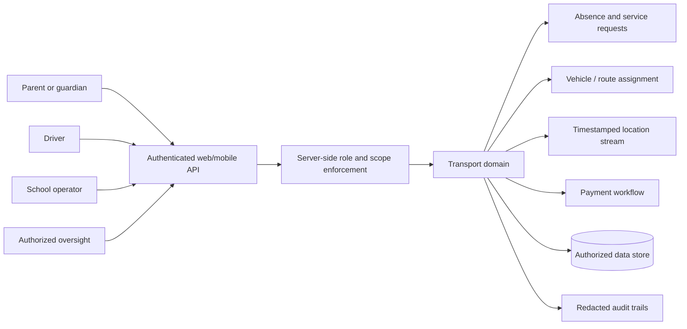

# Sepand — Roles, State and Safety Boundaries

This diagram is a **logical, privacy-safe reference**, not a map of deployed servers.

## State invariant examples
- Parent-child relationships must be checked for every request, even after switching students in a client.
- Driver may read only assigned route data, and cannot elevate themselves by supplying a school ID.
- A location older than the defined freshness interval should be marked stale, not live.
- Attendance changes should be auditable and idempotent per student/date/service.
- Payment and enrollment states must not be silently conflated.
- School reference-data imports require normalization, conflict review, dry-run and migration rollback.

## Sensitive-data guardrails
Student identities and movement traces are sensitive. No real route, personally identifying student data, institution code, location point, support ticket, external service credential or raw monitoring log is committed to this public repository.

## Validation plan
Use fictional parents, students, drivers and schools in a seeded fixture; assert 403 for cross-guardian reads, rejection of stale location as “live”, safe payment retries and no destructive school-import operations until reviewed. The demo is illustrative, not evidence that these tests pass against private production.
