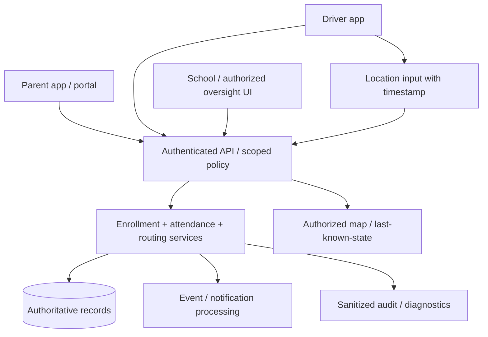

# Sepand — Multi-Role School Transport System: Engineering Case Study

**Public-safe summary**, 2026-10-13. The application and user data are private; operational facts below are described at feature/problem-category level only. **No production metric or agency endorsement is implied.**

## 1. Problem
A school transportation workflow connects parents, students, drivers, schools and governing/operational organizations. These actors need different permissions and different views of a single evolving transport service, including who is absent, where vehicles are, who is assigned to whom and whether service requests have been accepted.

The core technical difficulty is **consistent state and scoped permissions** across mobile/web experiences and organizations, while protecting the especially sensitive data of children.

## 2. Representative role boundaries
| Role | Typical permitted data | Guardrail |
| --- | --- | --- |
| Parent/guardian | Own child's route, assigned driver, absence reporting | Never other students' locations or contact details |
| Driver | Assigned route, relevant attendance and status | Only assigned children/route |
| School operator | Students and requests in their institution | School scope, not national/global access |
| Education/oversight role | Authorized rollups and operations | Organizational/geographic scope |
| Platform support | Incident triage with minimum necessary data | Auditable, time-limited access |

The table is an architectural *policy target*; per-deployment permission matrices and current code are private and are not independently audited here.

## 3. Engineering workflows

### A. Guardian authentication and child switching
A parent-facing flow may use OTP and CAPTCHA, then display the children the logged-in guardian is authorized to manage. Selecting another child requires revalidating the relationship **on the server**, not merely changing a client-side ID.

### B. Attendance and absence
An absence request must have a clear date/service/child scope, idempotent submission semantics and a visible effective state. Conflicts between parent and driver updates need a documented authority rule; retries must not create duplicate attendance entries.

### C. Live driver location and trip status
Location updates are time-dependent and imperfect: missing GPS, offline clients, out-of-order timestamps and intermittent connections. A UI should show **last known at** separately from **currently online** and must not present stale coordinates as live truth. Protect route traces with narrow role access and data retention controls.

### D. Payment failure and record lifecycle
A payment callback or interrupted checkout can leave related records in inconsistent states if business operations are not idempotent. A robust design separates payment intent from service enrollment, protects canonical records from accidental deletion and retries with explicit status transitions.

### E. School reference-data reconciliation
Importing a list of school records from a separate authority raises matching conflicts, duplicate codes, mismatched city assignments and missing location/address fields. Compare in **dry-run** first, group decisions into insert/update/conflict/review, require review on ambiguous matches and maintain a rollback plan. No original school datasets or counts are published.

## 4. Reference architecture

**This is not a source-derived production network topology.**

## 5. Engineering challenges & mitigations
| Challenge | Engineering response | How to verify without customer data |
| --- | --- | --- |
| Duplicate identity/vehicle input | Normalize identifiers; enforce backend uniqueness; return explicit conflict | Synthetic duplicate submissions |
| Late/out-of-order GPS | Timestamps, freshness threshold, last-known vs online distinction | Inject out-of-order synthetic updates |
| Permission leakage across roles | Server policy scoped by entity and geography | Negative authorization test matrix |
| Retry after payment failure | Idempotency and canonical lifecycle | Replay callback fixture |
| Large school lists | Bounded batch process with dry-run and review queue | Invented CSV reconciliation |
| Transient OTP traffic | Throttling, structured errors and observed retry behavior | Controlled synthetic rate tests |

## 6. Evidence boundary
This case study is anchored in actual categories of implementation and operational problem-solving discussed during the project, **not** in a published source audit. Claims of exact uptime, throughput, school counts, public contracts or production deployment readiness are intentionally excluded.

The [offline demonstration](demo/index.html) shows one fake route and attendance example. It cannot query or alter the real system.

## 7. Next steps for a stronger engineering portfolio
1. Publish a sanitized authorization matrix vetted by the system owner.
2. Add an offline attendance/route state-machine tester.
3. Produce a fake school import/deduplication fixture.
4. Prepare a redacted incident postmortem and performance methodology with owner approval.
5. Improve accessibility and RTL support in public demos while keeping all personal data fictional.
